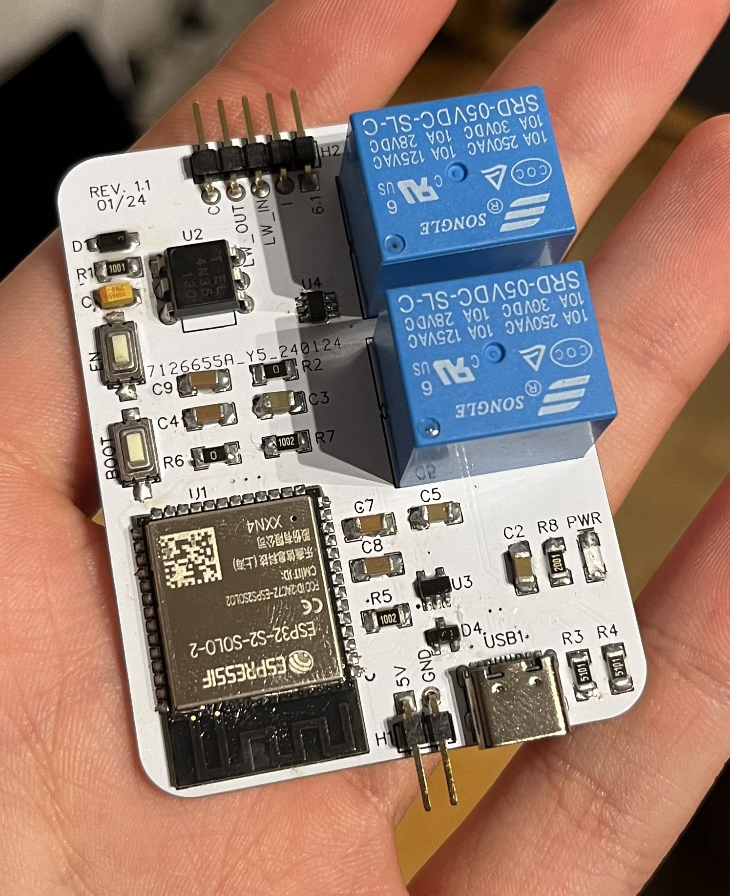
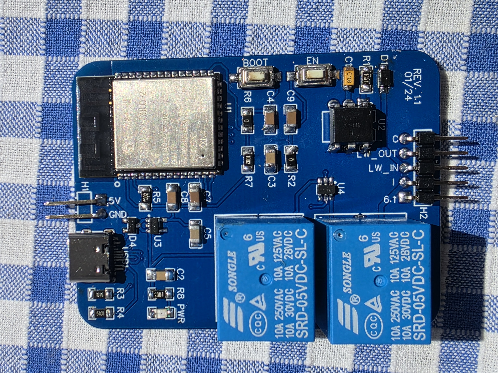
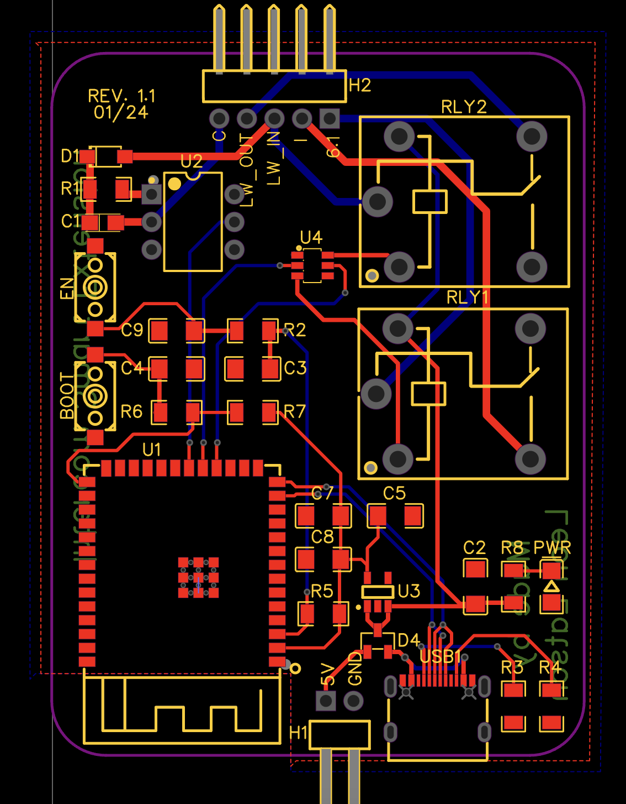

# ESP32 Smart Intercom Extension
ESP32 based pcb for controlling a Siedle HT611-01 Intercom

---

## Project Gallery

<table>
<tr>
<td align="center">
 
Built by me (@leonlatsch)
</td>
<td align="center">
 
Built by @besanur
</td>
<td align="center">
 
PCB Layout
</td>
</tr>
</table>

---

## Overview

This is a project I did together with  
https://github.com/T3chguys

Its a pcb (printed circuit board) that controls an existing intercom device installed in a multi family home. Similar to the Nuki Opener.  
Can also be used for other devices meeting some requirements.

---

## Features

- Open the main door
- A sensor for the doorbell
- Mute the doorbell
- Ring to open

---

## Getting Started

Warning: I am by no means an expert. Do this at your own risk.

### Prequsitions

You will need:

- Soldering equipment suitable for soldering smd components (iron, tin, flux, tweezers, etc.)
- Some jumper wires and clamps (depending on the device it will be installed in)
- Some money (not much)

---

## Ordering Parts

### Ordering the components

There is a BOM (bill of materials) csv file for every revision in the github releases section.  
Just use your favorite supplier and import it.

I used https://lcsc.com so the BOM also contains LCSC part numbers.

Use the exact same parts, or similar ones if they are out of stock.  
Just make sure to use the correct value and package.  
For most smd parts its 1206 but double check the BOM.

For me the parts were around 5$ in 2024.

---

### Ordering the pcb

- Download the Gerber zip from the same release
- Upload it to your pcb manufacturer (I used https://jlcpcb.com)
- Keep most settings default, choose color if you want
- Order pcb only (unless you want assembly)

This was around 2$ in 2024.

Now wait for the parts to arrive and buy some flux. You will need it.

---

## Assembling

Once all parts arrived you can start assembling.

If you never soldered smd before, watch a tutorial first:  
https://www.youtube.com/watch?v=4GrQNH80oDY

Use the pcb layout image for part placement.

---

## Function Testing

Use a multimeter to test connections before powering the board.

### USB check

1. Plug in a USB-A to USB-C cable
2. Test connection from the exposed data and power pins in the USB-A port
3. Make sure D+ and D- are NOT connected
4. Make sure USB power is connected to D4

Then power the board and verify:
- D4 outputs around 5V
- U3 outputs around 3.3V

If this works you are ready to flash.

---

## Installing the firmware

I used ESPHome to flash this device.  
The yaml config is in this repo.

To get started see: https://esphome.io/

Create a new ESPHome device and copy the yaml into it.  
Add your wifi credentials and an api key.

Pins should match but you can verify with the schematic:  
pcb/rev_1.1/pcb_schematic_1.1.pdf

---

## Installation (Siedle HT611-01)

Connect the labeled pins to the same labels on the intercom.

1. Remove the cable that connects LW on the intercom to the bell
2. Connect it to LW_IN on this board
3. Connect LW_OUT to the bell plus
4. Connect C to the bell minus
5. Keep the bell minus connected to the intercom
6. Connect 6.1 to 6.1 on the intercom
7. Connect I to I on the intercom
8. Connect 5V to a power supply
9. Connect GND to ground

You can also power the board via USB-C.

Do NOT connect 5V and USB at the same time.

### Pin explanation

- 6.1 — Door opener plus  
- I — Door opener minus  
- LW_IN — Bell input  
- LW_OUT — Bell output  
- C — Bell minus  
- 5V — 5V power supply  
- GND — Ground  

---

## How it works

Mostly relays.

- Opening the door is handled by a relay simulating the button press
- Muting the doorbell uses a NC relay, so the bell rings if the board is off
- The doorbell sensor uses an optocoupler to detect the AC signal
- The rest is standard ESP32 support circuitry

Everything connected to the intercom is electrically isolated from the ESP32.

---

## Hardware requirements for other intercoms

If you want to use this with another intercom:

- Door opener circuit to connect to
- Ring circuit to connect to
- Max 2A on the ring circuit (trace limit)
- Max 250V switching voltage (relay limit)
- Bell signal around 12V AC (DC not tested)
